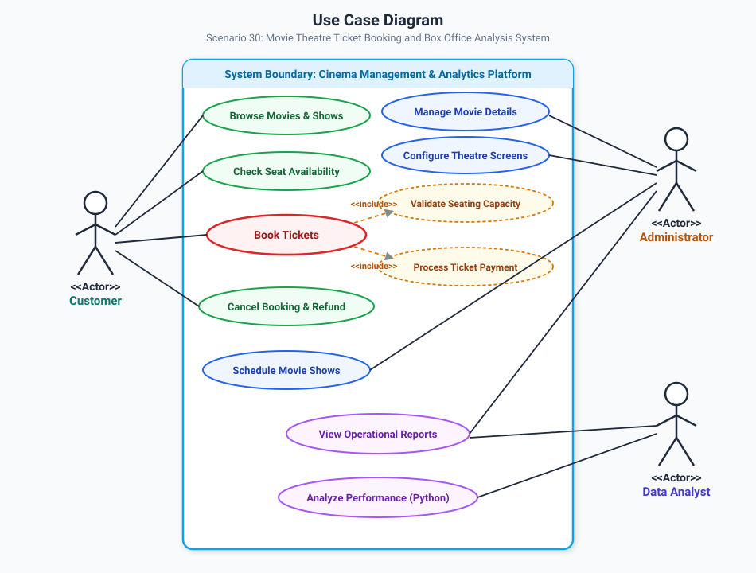
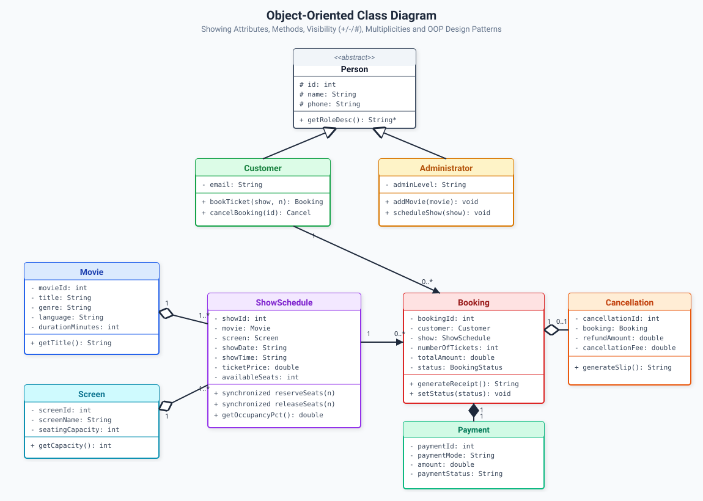
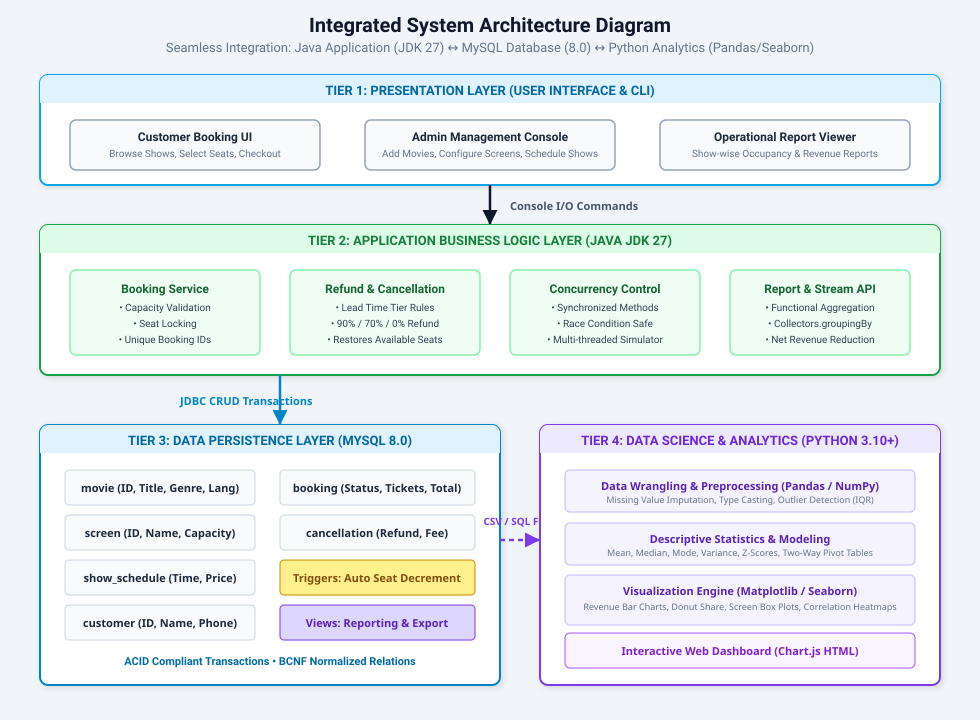
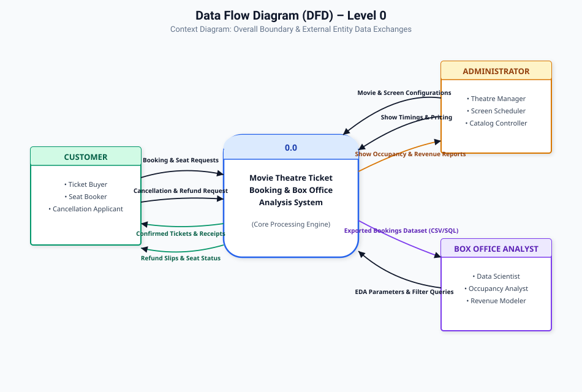
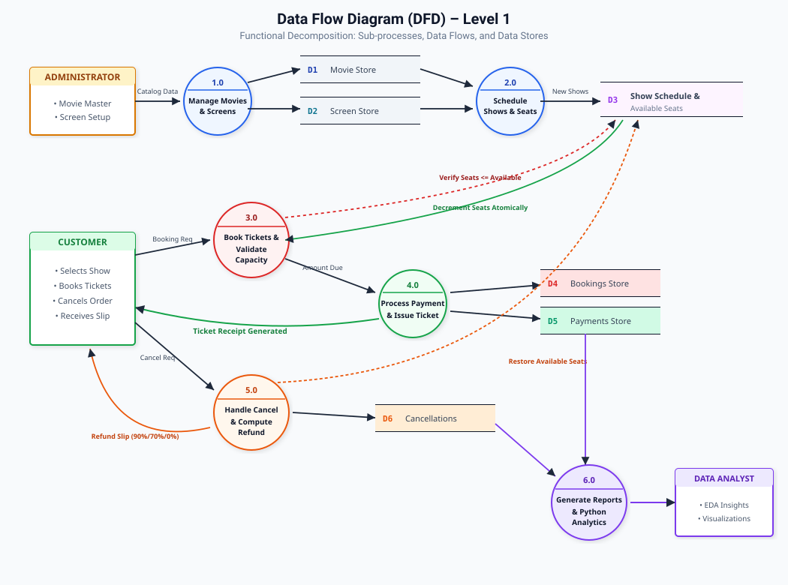
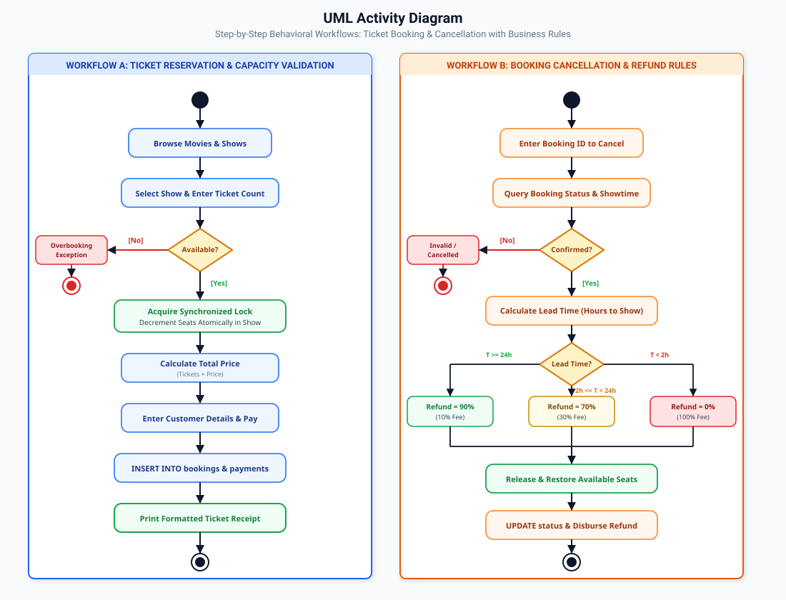
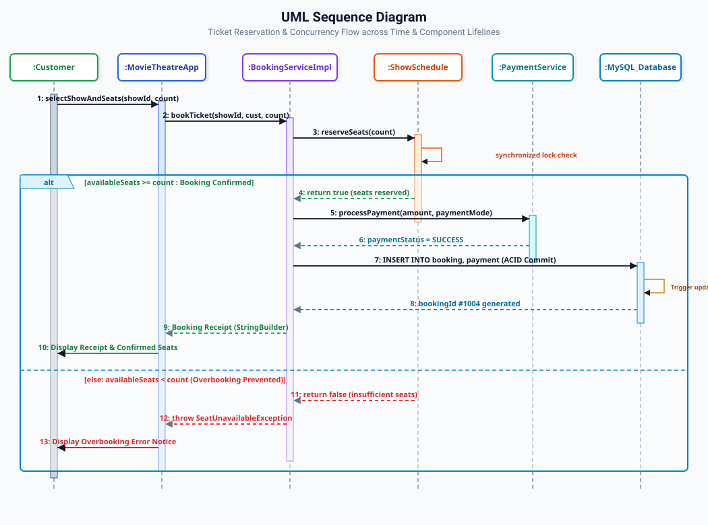

# SYSTEM ARCHITECTURE AND DESIGN SPECIFICATION
## Movie Theatre Ticket Booking and Box Office Analysis System
### Course Code: 25ITT33 - Software Engineering (Unit 2 & Unit 3 Alignment)
**Institution:** Velalar College of Engineering and Technology (Autonomous), Erode - 12  
**Department:** Information Technology | **Class:** 25IT3A & 25IT3B  
**Scenario:** 30 (Register Nos: 30, 60, 90, 120)

---

## Document Index & Cross References
- **Software Requirements Specification:** Refer to [SRS_Document.md](SRS_Document.md) for full Functional (FR-01 to FR-10) and Non-Functional Requirements.
- **Software Testing & QA:** Refer to [Software_Testing_Document.md](Software_Testing_Document.md) for Test Plan, Black-box (BVA/EP) & White-box Test Cases.
- **Project Sizing & Metrics:** Refer to [Requirements_and_Syllabus_Mapping.md](Requirements_and_Syllabus_Mapping.md) for Function Point and COCOMO cost models.

---

## 1. Use Case Diagram

The Use Case Diagram captures the functional boundaries of the cinema multiplex system, illustrating interactions between primary actors (**Customer**, **Theatre Administrator**, and **Box Office Analyst**) and the core operational use cases.

### 1.1 Detailed Actor Specifications
- **Customer:** Browses movies and showtimes, checks real-time seat availability, books tickets, executes payment, receives tickets, and cancels bookings for applicable refunds.
- **Theatre Administrator:** Manages the film distribution catalog, configures physical auditorium screens and capacities, schedules showtimes, sets ticket prices, and monitors operational occupancy reports.
- **Box Office Analyst:** Ingests transaction and occupancy data into Python, performs descriptive statistical analysis, and generates box office visualizations.

### 1.2 Use Case Descriptions & Relationships
- **`UC-01: Browse Movies & Shows`:** Allows customers and admins to view active movies and schedules.
- **`UC-02: Check Seat Availability`:** Dynamically queries available vs. booked seats.
- **`UC-03: Book Tickets`:** Core reservation flow.
  - `<<include>> UC-04: Validate Seating Capacity:` Enforces strict check ($Requested \le Available$) before proceeding.
  - `<<include>> UC-05: Process Ticket Payment:` Verifies payment authorization before seat allocation.
- **`UC-06: Cancel Booking & Refund`:** Computes lead-time tiered refunds (90%, 70%, 0%) and restores available seats.
- **`UC-07 to UC-09: Admin Operations`:** CRUD management of movies, screens, and show schedules.
- **`UC-10 & UC-11: Reporting & Analytics`:** Generates show-wise occupancy reports and triggers Python data science routines.

---

## 2. Object-Oriented Class Diagram

The Class Diagram illustrates the structural object model, attributes, methods, visibilities (`+` Public, `-` Private, `#` Protected), and object-oriented design patterns.

### 2.1 Core Classes & Relationships
1. **`Person` (Abstract Superclass):** Demonstrates **Inheritance** and **Dynamic Method Dispatch** (Unit 2).
   - Encapsulates `# id: int`, `# name: String`, `# phone: String`, `# email: String`.
   - Defines abstract method `+ getRoleDescription(): String`.
2. **`Customer` (Subclass of Person):** Inherits demographics via `super()` and implements customer-specific booking operations.
3. **`Administrator` (Subclass of Person):** Implements administrative show scheduling and movie catalog controls.
4. **`Movie` & `Screen`:** Master domain entities for films and auditorium screens.
5. **`ShowSchedule`:** Central aggregate binding Movie, Screen, Showtime, Ticket Price, and dynamic seat inventory.
   - Contains thread-synchronized methods: `+ synchronized reserveSeats(int count)` and `+ synchronized releaseSeats(int count)`.
6. **`Booking`:** Represents a ticket reservation transaction; formats receipts using `StringBuilder`.
7. **`Cancellation` & `Payment`:** 1-to-1 associative entities handling refund calculations and billing settlements.

---

## 3. System Architecture Diagram

The System Architecture Diagram displays the multi-tier enterprise architecture, highlighting how the **Java Application (JDK 27)**, **MySQL Database (8.0)**, and **Python Analytics Subsystem** cooperate.

### 3.1 Architectural Tier Breakdown
- **Tier 1 (Presentation Layer):** Menu-driven console CLI, customer reservation interface, and admin console.
- **Tier 2 (Application Business Logic Layer - Java JDK 27):**
  - Services: `BookingServiceImpl`, `ReportServiceImpl`.
  - Business Rules: Capacity validation, lead-time tiered refund engine, thread synchronization.
  - DAO Layer: `DBConnection`, `MovieDAO`, `BookingDAO`.
- **Tier 3 (Data Persistence Layer - MySQL 8.0):**
  - Relational schema enforcing BCNF normalization, referential integrity (`FOREIGN KEY`), check constraints.
  - Database triggers (`trg_after_booking_insert`, `trg_after_cancellation_insert`) ensuring seat counts decrement and restore automatically.
- **Tier 4 (Data Science & Analytics Subsystem - Python 3.10+):**
  - Ingestion via SQL query/CSV export (`theatre_bookings.csv`).
  - Preprocessing, IQR outlier treatment, and descriptive statistics ($Z$-Scores) using NumPy and Pandas.
  - Visualization Engine using Matplotlib, Seaborn, and the interactive web dashboard.

---

## 4. Data Flow Diagram (DFD) – Level 0

The Level 0 Context Diagram establishes the macroscopic boundary of the system, identifying all external entities and high-level data flows.

### 4.1 Boundary Data Exchanges
- **Customer $\leftrightarrow$ System:** Inflows include booking requests, seat selections, cancellations, and payments. Outflows include live seat availability, booking confirmation receipts, and cancellation refund slips.
- **Administrator $\leftrightarrow$ System:** Inflows include movie metadata, screen layouts, show timings, and ticket prices. Outflows include operational occupancy reports.
- **Box Office Analyst $\leftrightarrow$ System:** Inflows include analytical queries and filter parameters. Outflows include exported transaction feeds (CSV/SQL).

---

## 5. Data Flow Diagram (DFD) – Level 1

The Level 1 DFD decomposes the central process into six operational sub-processes and maps them to physical data stores.

### 5.1 Sub-Processes and Data Stores
- **Process 1.0 (Manage Movies & Screens):** Inputs catalog data from Admin and writes to **D1: Movie Store** and **D2: Screen Store**.
- **Process 2.0 (Schedule Shows & Seats):** Reads D1 & D2, initializes seating capacity, and writes to **D3: Show Schedule Store**.
- **Process 3.0 (Book Tickets & Validate Capacity):** Receives customer orders, queries D3 to verify remaining seats, and decrements available seats atomically.
- **Process 4.0 (Process Payment & Billing):** Computes total bill, processes transaction, logs to **D4: Booking Store** and **D5: Payment Store**, and returns ticket receipts.
- **Process 5.0 (Handle Cancellation & Compute Refund):** Reads D4, calculates lead-time refund percentage, updates D3 (restores seats), records in **D6: Cancellation Store**, and issues refund slips.
- **Process 6.0 (Generate Reports & Python Analytics):** Ingests D1–D6 to produce management reports and feed the Python EDA pipeline.

---

## 6. UML Activity Diagram

The Activity Diagram models the step-by-step sequential and conditional workflows for ticket reservation and cancellation refund processing.

### 6.1 Workflow Logic
- **Workflow A (Ticket Booking):**
  - Start $\to$ Browse Shows $\to$ Select Show & Tickets $\to$ Decision: $Requested \le Available$?
  - *If No:* Raise `SeatUnavailableException` $\to$ Display Overbooking Notice $\to$ End.
  - *If Yes:* Acquire Synchronized Thread Lock $\to$ Decrement Available Seats $\to$ Calculate Total Price $\to$ Enter Customer Details $\to$ INSERT INTO bookings $\to$ Generate Receipt $\to$ End.
- **Workflow B (Cancellation & Refunds):**
  - Start $\to$ Enter Booking ID $\to$ Decision: Valid & Status == 'CONFIRMED'?
  - *If No:* Display "Invalid or Already Cancelled" $\to$ End.
  - *If Yes:* Compute Lead Time Hours $T$ to Show:
    - $T \ge 24\text{ hours} \implies \text{Refund } 90\%$ ($10\%$ cancellation fee).
    - $2\text{ hours} \le T < 24\text{ hours} \implies \text{Refund } 70\%$ ($30\%$ fee).
    - $T < 2\text{ hours} \implies \text{Refund } 0\%$ ($100\%$ non-refundable fee).
  - Restore Booked Seats back into Show Inventory $\to$ Update status to `CANCELLED` $\to$ Print Refund Slip $\to$ End.

---

## 7. UML Sequence Diagram

The Sequence Diagram details the chronological interaction across system lifelines during a ticket booking transaction.

### 7.1 Chronological Message Exchanges
1. Customer enters show choice and seat volume into `MovieTheatreApp` CLI.
2. `MovieTheatreApp` invokes `createBooking()` on `BookingServiceImpl`.
3. `BookingServiceImpl` calls `reserveSeats()` on `ShowSchedule`.
4. `ShowSchedule` enters a synchronized monitor lock:
   - **Alternative Flow (Capacity Available):**
     5. Show confirms reservation; `BookingServiceImpl` calls `PaymentService.processPayment()`.
     6. `PaymentService` confirms transaction success.
     7. `BookingServiceImpl` executes atomic SQL insert into `MySQL_Database`.
     8. Database trigger automatically updates `show_schedule.available_seats`.
     9. `BookingServiceImpl` generates formatted receipt via `StringBuilder`.
     10. CLI outputs confirmed ticket receipt to Customer.
   - **Alternative Flow (Overbooking Prevented):**
     11. `ShowSchedule` rejects reservation ($Requested > Available$).
     12. `BookingServiceImpl` throws `SeatUnavailableException`.
     13. CLI intercepts exception and outputs remaining available seat warning to Customer.
