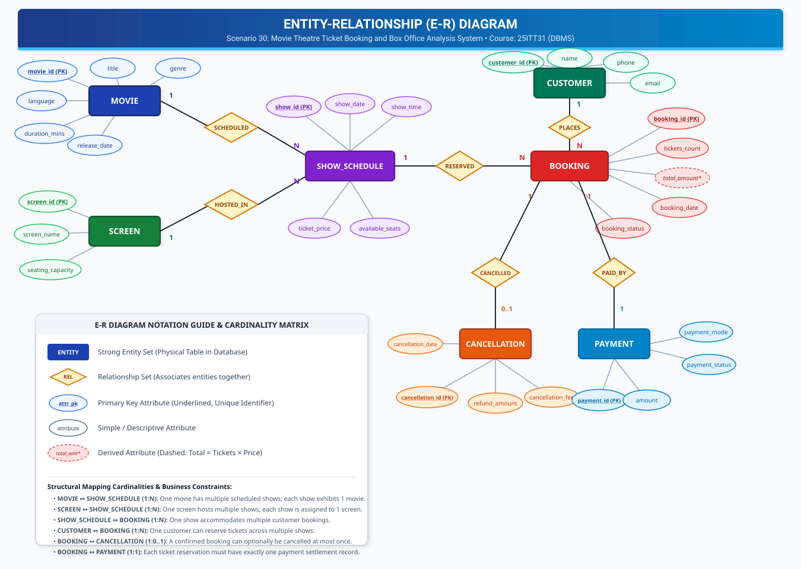
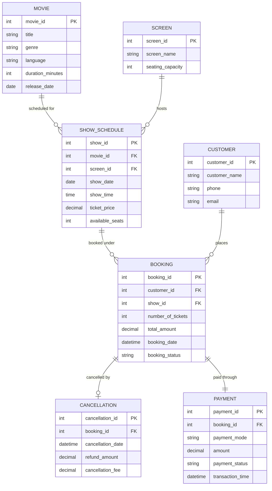

# ENTITY-RELATIONSHIP (E-R) DIAGRAM AND RELATIONAL MODEL
## Movie Theatre Ticket Booking and Box Office Analysis System
### Course Code: 25ITT31 - Database Management Systems (Unit 1 Alignment)
**Institution:** Velalar College of Engineering and Technology, Erode - 12  
**Department of Information Technology**

---

## 1. Conceptual Design: Entity Sets & Attributes

### 1.1 Strong Entity Sets
1. **MOVIE**
   - `movie_id` (PK, Integer, Unique Identifier)
   - `title` (VARCHAR(150), Title of the movie)
   - `genre` (VARCHAR(50), e.g., Action, Sci-Fi, Drama)
   - `language` (VARCHAR(30), e.g., Tamil, English, Hindi)
   - `duration_minutes` (Integer, Running time in minutes)
   - `release_date` (DATE)

2. **SCREEN**
   - `screen_id` (PK, Integer, Unique Identifier)
   - `screen_name` (VARCHAR(50), e.g., Screen 1, Screen 2 - IMAX)
   - `seating_capacity` (Integer, Total physical capacity)

3. **SHOW_SCHEDULE**
   - `show_id` (PK, Integer, Unique Identifier)
   - `movie_id` (FK referencing MOVIE)
   - `screen_id` (FK referencing SCREEN)
   - `show_date` (DATE)
   - `show_time` (TIME)
   - `ticket_price` (DECIMAL(10,2))
   - `available_seats` (Integer, dynamic remaining seats)

4. **CUSTOMER**
   - `customer_id` (PK, Integer, Unique Identifier)
   - `customer_name` (VARCHAR(100))
   - `phone` (VARCHAR(15), Unique)
   - `email` (VARCHAR(100))

### 1.2 Associative & Transactional Entity Sets
5. **BOOKING**
   - `booking_id` (PK, Integer, Unique Identifier)
   - `customer_id` (FK referencing CUSTOMER)
   - `show_id` (FK referencing SHOW_SCHEDULE)
   - `number_of_tickets` (Integer)
   - `total_amount` (DECIMAL(10,2), Derived: $Tickets \times Price$)
   - `booking_date` (DATETIME)
   - `booking_status` (VARCHAR(20), 'CONFIRMED' or 'CANCELLED')

6. **CANCELLATION**
   - `cancellation_id` (PK, Integer, Unique Identifier)
   - `booking_id` (FK referencing BOOKING, Unique)
   - `cancellation_date` (DATETIME)
   - `refund_amount` (DECIMAL(10,2))
   - `cancellation_fee` (DECIMAL(10,2))

7. **PAYMENT**
   - `payment_id` (PK, Integer, Unique Identifier)
   - `booking_id` (FK referencing BOOKING)
   - `payment_mode` (VARCHAR(30), e.g., UPI, Card, NetBanking)
   - `payment_status` (VARCHAR(20), 'SUCCESS', 'REFUNDED')
   - `transaction_time` (DATETIME)

---

## 2. Mapping Cardinalities & Structural Constraints

- **MOVIE to SHOW_SCHEDULE:** One-to-Many ($1:N$). A movie can be scheduled in many shows; each show exhibits exactly one movie.
- **SCREEN to SHOW_SCHEDULE:** One-to-Many ($1:N$). A screen hosts many shows; each show is hosted in exactly one screen.
- **SHOW_SCHEDULE to BOOKING:** One-to-Many ($1:N$). A show can have multiple customer bookings; each booking pertains to exactly one show.
- **CUSTOMER to BOOKING:** One-to-Many ($1:N$). A customer can place multiple bookings; each booking belongs to one customer.
- **BOOKING to CANCELLATION:** One-to-One ($1:1$, Optional). A booking may have at most one cancellation record.
- **BOOKING to PAYMENT:** One-to-One ($1:1$, Mandatory). Each confirmed booking has exactly one payment record.

---

## 3. Entity-Relationship (E-R) Diagram

The complete conceptual E-R Diagram for Scenario 30 illustrates all 7 strong and associative entities, their primary keys (underlined), derived attributes (dashed), and mapping cardinalities:

### 3.1 Structural ER Specification (Mermaid Notation)

---

## 4. Logical Relational Model & Schema Definition

The relational schemas derived from the conceptual E-R model are specified as follows:

1. **`Movie`** ($\underline{\text{movie\_id}}$, title, genre, language, duration\_minutes, release\_date)
2. **`Screen`** ($\underline{\text{screen\_id}}$, screen\_name, seating\_capacity)
3. **`ShowSchedule`** ($\underline{\text{show\_id}}$, $\text{movie\_id}^*$, $\text{screen\_id}^*$, show\_date, show\_time, ticket\_price, available\_seats)
   - Foreign Key: `movie_id` $\to$ `Movie(movie_id)`
   - Foreign Key: `screen_id` $\to$ `Screen(screen_id)`
4. **`Customer`** ($\underline{\text{customer\_id}}$, customer\_name, phone, email)
5. **`Booking`** ($\underline{\text{booking\_id}}$, $\text{customer\_id}^*$, $\text{show\_id}^*$, number\_of\_tickets, total\_amount, booking\_date, booking\_status)
   - Foreign Key: `customer_id` $\to$ `Customer(customer_id)`
   - Foreign Key: `show_id` $\to$ `ShowSchedule(show_id)`
6. **`Cancellation`** ($\underline{\text{cancellation\_id}}$, $\text{booking\_id}^*$, cancellation\_date, refund\_amount, cancellation\_fee)
   - Foreign Key: `booking_id` $\to$ `Booking(booking_id)`
7. **`Payment`** ($\underline{\text{payment\_id}}$, $\text{booking\_id}^*$, payment\_mode, amount, payment\_status, transaction\_time)
   - Foreign Key: `booking_id` $\to$ `Booking(booking_id)`

*(Underlined attributes represent Primary Keys; asterisks $*$ denote Foreign Keys)*

---

## 5. Formal Relational Algebra Expressions (Unit 1 Alignment)

### 5.1 Selection ($\sigma$) and Projection ($\pi$)
- Retrieve all Sci-Fi movies in English:
  $$\pi_{\text{title, duration\_minutes}} (\sigma_{\text{genre='Sci-Fi'} \land \text{language='English'}} (\text{Movie}))$$

### 5.2 Natural Join ($\bowtie$)
- Retrieve all shows displaying movie title and screen name:
  $$\pi_{\text{show\_id, title, screen\_name, show\_date, show\_time}} (\text{ShowSchedule} \bowtie \text{Movie} \bowtie \text{Screen})$$

### 5.3 Aggregation ($\mathcal{G}$)
- Calculate total gross ticket revenue generated per movie:
  $$\text{movie\_id} \ \mathcal{G}_{\text{SUM}(\text{total\_amount}) \to \text{GrossRevenue}} (\sigma_{\text{booking\_status='CONFIRMED'}} (\text{Booking} \bowtie \text{ShowSchedule}))$$

### 5.4 Difference ($-$) / Anti-Join
- Find movies that currently have zero scheduled shows:
  $$\pi_{\text{movie\_id, title}}(\text{Movie}) - \pi_{\text{movie\_id, title}}(\text{Movie} \bowtie \text{ShowSchedule})$$
