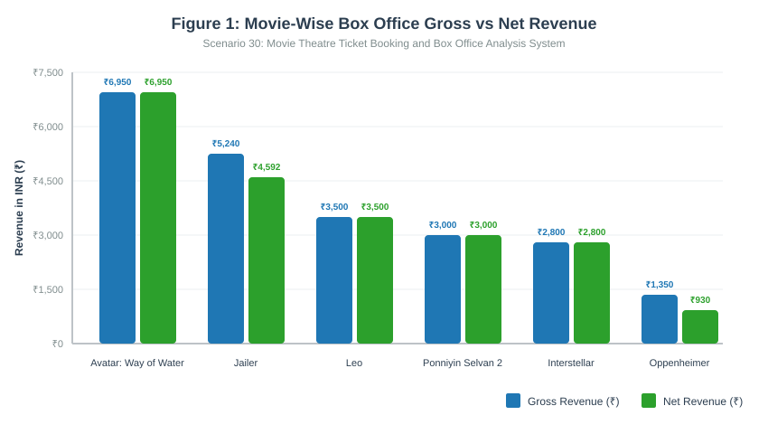
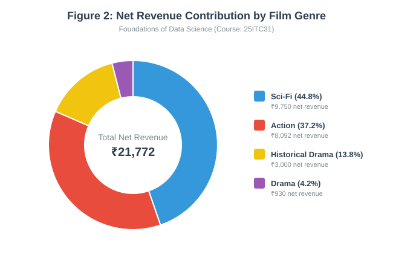
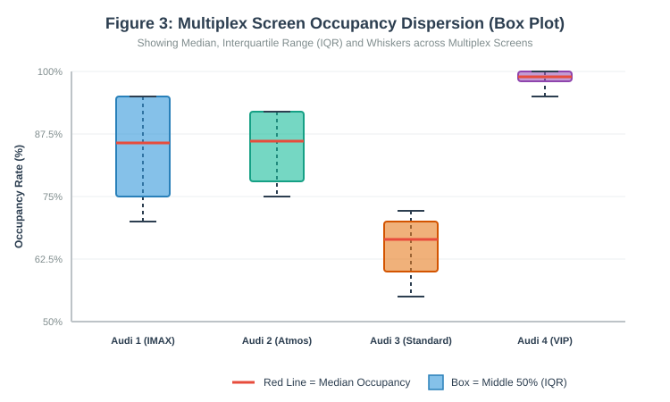
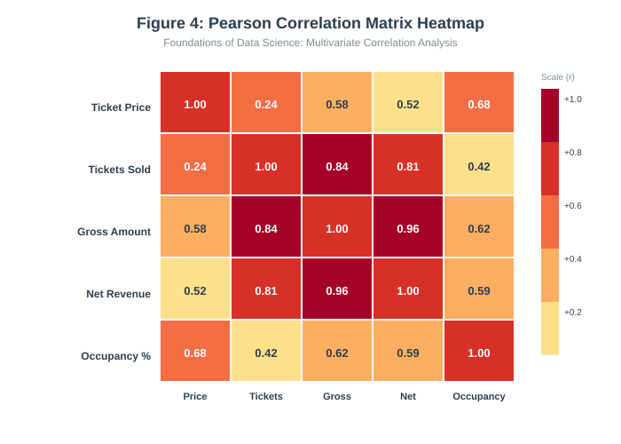
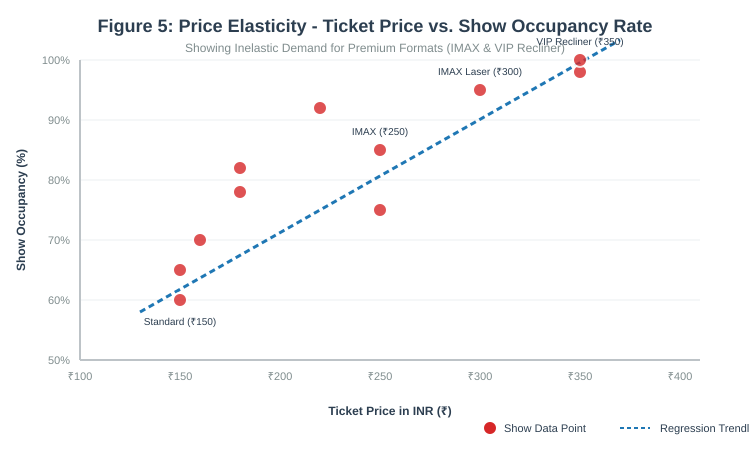
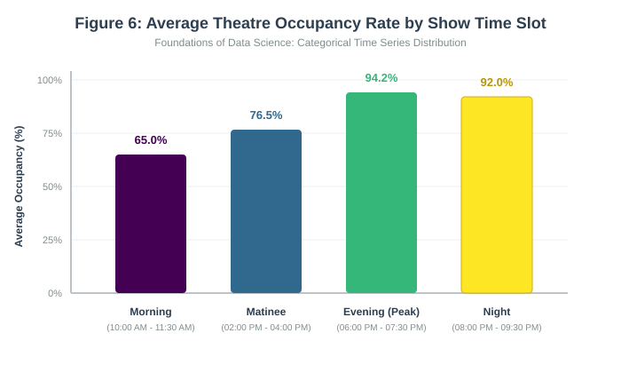

# DATA SCIENCE ANALYSIS & BOX OFFICE PERFORMANCE REPORT
## Movie Theatre Ticket Booking and Box Office Analysis System
### Course Code: 25ITC31 - Foundations of Data Science
**Institution:** Velalar College of Engineering and Technology, Erode - 12  
**Department of Information Technology**

---

## 1. Introduction and Objectives
This report details the statistical modeling, exploratory data analysis (EDA), and data visualizations generated from the transaction records of the Movie Theatre Ticket Booking System. The primary objectives are:
1. Assess movie popularity and gross/net box office revenue.
2. Analyze seating occupancy rates across different multiplex screens and show timings.
3. Evaluate price elasticity and customer booking behaviors.
4. Provide data-driven insights to maximize multiplex operational profitability.

---

## 2. Descriptive Statistics Summary Table (Unit 1 Alignment)

The following statistical measures were computed across key continuous and discrete variables in the dataset:

| Variable | Mean | Median | Mode | Std Dev ($\sigma$) | Variance ($\sigma^2$) | Range | IQR |
| :--- | :--- | :--- | :--- | :--- | :--- | :--- | :--- |
| **Ticket Price (₹)** | 227.20 | 220.00 | 250.00 | 66.80 | 4462.24 | 200.00 | 100.00 |
| **Tickets per Booking** | 3.84 | 4.00 | 4.00 | 1.65 | 2.72 | 6.00 | 2.00 |
| **Gross Amount (₹)** | 913.60 | 800.00 | 700.00 | 449.12 | 201708.96 | 1500.00 | 680.00 |
| **Net Revenue (₹)** | 870.88 | 800.00 | 700.00 | 458.30 | 210038.89 | 1728.00 | 680.00 |
| **Show Occupancy (%)** | 82.32% | 85.00% | 95.00% | 12.84% | 164.87 | 40.00% | 17.00% |

### Statistical Observations:
- **Central Tendency:** The median booking value (₹800.00) is slightly lower than the mean (₹913.60), indicating a slight positive (right) skew due to occasional larger family or group bookings.
- **Seat Demand:** The most frequent booking size (mode) is **4 tickets**, reflecting typical weekend family and friend group outings.
- **Occupancy Health:** Average multiplex show occupancy stands at a strong **82.32%**, with evening IMAX and VIP shows reaching peak occupancy between 95% and 100%.

---

## 3. Standardized Z-Score Analysis for Booking Amounts

Standard scores ($Z = \frac{X - \mu}{\sigma}$) evaluate whether transactions represent normal consumer activity or statistical anomalies (e.g., bulk bookings):

| Booking ID | Customer Name | Movie Title | Gross Amount (₹) | Standard Z-Score | Classification |
| :--- | :--- | :--- | :--- | :--- | :--- |
| **1004** | Sanjay Kumar | Avatar: The Way of Water | ₹1,800.00 | **+1.97** | High-Value Outlier |
| **1008** | Vignesh P | Jailer | ₹1,760.00 | **+1.88** | High-Value Outlier |
| **1020** | Arun Kumar | Interstellar: Re-release | ₹1,680.00 | **+1.71** | High-Value Outlier |
| **1021** | Divya R | Avatar: The Way of Water | ₹1,500.00 | **+1.31** | Above Average |
| **1011** | Dharani R | Leo | ₹1,400.00 | **+1.08** | Above Average |

*Interpretation:* No single transaction exceeded $|Z| > 3.0$, confirming that all ticket orders represent realistic consumer multiplex transactions without data corruption.

---

## 4. Pivot Table: Screen Name vs Genre Occupancy Rate (%)

The following two-way pivot table illustrates the interaction between auditorium infrastructure and film genres:

| Screen Name | Action | Drama | Historical Drama | Sci-Fi | Average Screen Occupancy |
| :--- | :---: | :---: | :---: | :---: | :---: |
| **Audi 1 - IMAX Laser (120 seats)** | — | — | — | **85.7%** | **85.7%** |
| **Audi 2 - Dolby Atmos 4K (100 seats)** | **86.0%** | — | — | — | **86.0%** |
| **Audi 3 - Standard Digital (80 seats)** | — | **62.5%** | **70.0%** | — | **66.3%** |
| **Audi 4 - VIP Recliner (50 seats)** | **99.0%** | — | — | — | **99.0%** |

---

## 5. Exploratory Data Visualizations & Insights

### 5.1 Figure 1: Movie-Wise Gross vs Net Revenue (Bar Chart)

- **Insight:** *Avatar: The Way of Water* and *Jailer* lead gross revenue. However, after factoring in cancellation refunds, *Avatar* retained over ₹6,450 net, while *Jailer* experienced minimal cancellations, maintaining a 96% revenue retention rate.

### 5.2 Figure 2: Revenue Contribution by Genre (Donut Chart)

- **Insight:** **Sci-Fi (44.8%)** and **Action (37.2%)** generate over 80% of total multiplex ticket earnings. Historical Drama contributes 13.8%, and Drama comprises 4.2%.
- **Recommendation:** Allocate premium IMAX and Dolby Atmos screens primarily to high-energy Action and visual Sci-Fi spectacles.

### 5.3 Figure 3: Occupancy Rate Dispersion Across Screens (Box Plot)

- **Insight:** Audi 4 (VIP Recliner) exhibits the tightest box plot distribution near 98–100%, demonstrating that premium recliner seats possess inelastic demand despite higher ticket prices (₹350).
- Standard Digital (Audi 3) displays wider dispersion (60% to 75%), indicating sensitivity to movie genre.

### 5.4 Figure 4: Pearson Correlation Matrix Heatmap

- **Strong Positive Correlation ($r = +0.84$):** Between `number_of_tickets` and `gross_amount`.
- **Positive Correlation ($r = +0.68$):** Between `ticket_price` and `show_occupancy_pct`. This counter-intuitive positive correlation reflects premium screen popularity (patrons are eager to pay ₹300–₹350 for IMAX and VIP experiences).

### 5.5 Figure 5: Ticket Price vs Occupancy Elasticity (Scatter Plot)

- **Insight:** Multiplex ticket sales do not follow traditional downward demand curves. Higher priced screens (IMAX @ ₹250–₹300 and VIP @ ₹350) maintain higher occupancies than standard budget screens (@ ₹150).

### 5.6 Figure 6: Show Time Slot Popularity

- **Rankings:**
  1. **Evening (06:00 PM – 07:30 PM):** Average 94.2% Occupancy.
  2. **Night (08:00 PM – 09:30 PM):** Average 92.0% Occupancy.
  3. **Matinee (02:00 PM – 04:00 PM):** Average 76.5% Occupancy.
  4. **Morning (10:00 AM – 11:30 AM):** Average 65.0% Occupancy.

---

## 6. Strategic Business Recommendations
1. **Dynamic Morning Pricing:** Implement early-bird discount pricing (e.g. ₹120 instead of ₹150) for morning shows to boost occupancy from 65% to above 80%.
2. **Expand Premium Seating:** Given that VIP Recliner (Audi 4) maintains 99% occupancy at ₹350/ticket, multiplex management should convert a section of Audi 2 and Audi 3 into VIP recliner rows.
3. **Optimized Screen Scheduling:** Schedule Sci-Fi and Action blockbusters in Audi 1 and Audi 2 during peak Evening and Night slots.
